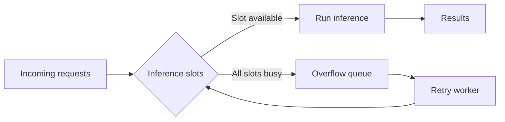

# Hey, I'm Khalid 👋

**Software · AI · Data**

I like building the systems behind AI products — the agents, data pipelines, and backend services that make everything work together.

I'm especially interested in what happens under the hood: moving and modeling data, orchestrating LLM workloads, and making systems reliable when real users and real constraints enter the picture.

---

## A little of what I've built

### Tawkeed Workspace

AI products, backend orchestration, and the engineering that keeps workloads moving.

I built workflows for asynchronous processing, job tracking, retries, and validation, along with observability for LLM usage and performance. Improving execution and provider validation reduced LLM cost and processing time by **~66%**.

> The products I've worked on serve **1M+ requests per month**.

### Government AI, running on-premise

Through Tawkeed, I delivered a local AI solution — from requirements and architecture to deployment in a restricted government environment.

It brings together local model serving, document ingestion and retrieval, embeddings, and an agent that works with files and structured data. One of my favorite parts was making inference work reliably under load:

**4 parallel slots** · **21 → 37 tokens/s** · **~30% → 0% lost requests** in measured workloads

## Data is a big part of the picture

I enjoy building the path from raw data to something people and applications can use: ingestion, transformations, orchestration, and analytics-ready models.

I'm interested in **ETL/ELT, data warehouses, lakehouses, and data quality** — especially designing pipelines that can be monitored, trusted, and reprocessed.

---

## Tools I work with

**Languages & applications**

 &nbsp; SQL · LangGraph

**Data**

  &nbsp;&nbsp;&nbsp;
  &nbsp;&nbsp;&nbsp;
  &nbsp;&nbsp;&nbsp;
  &nbsp;&nbsp;&nbsp;
  

Snowflake · dbt · Apache Airflow · Apache Spark · Databricks

**Cloud**

[LinkedIn](https://www.linkedin.com/in/khalid-aldawish) &nbsp;·&nbsp; [Email](mailto:aldaiwshkhalid@gmail.com)
